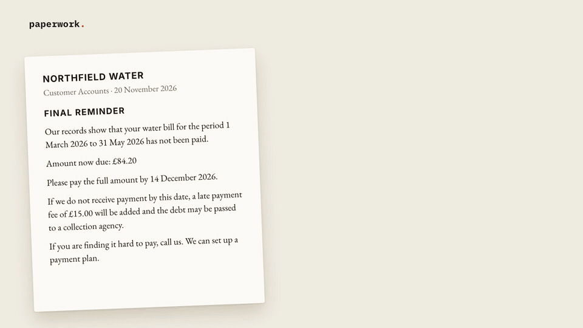

# Paperwork

**Show your AI assistant a letter, bill, contract or form. Get back, in plain words, what it
says, what you have to do, and by when.**

**[Try it on the website](https://askpaperwork.com/)**: click through a live example and copy the guide in one step.

Paperwork is a free skill: a small set of instructions you add to the AI assistant you
already use. It needs no account, no key and no payment of its own.



<sub>The demo uses an invented letter and a real answer from the test suite.
[Watch it as a video](assets/demo.mp4).</sub>

## What you can ask

| Say this | You get |
|---|---|
| "What is this?" | What it is, who sent it, what they want, by when, and any signs it is a scam |
| "Is this bill right?" | Each charge explained, anything charged twice or that doesn't add up, and questions to ask |
| "This is wrong, help me fight it" | Your strongest honest case, what proof to gather, and a letter ready to send |
| "Should I sign this?" | What it really costs, how you get out, and the terms to push back on |
| "Help me fill this in" | Each box explained, and what to put based on what you've told it |
| "I have a pile of these" | One list, most urgent first, with the one thing each needs |

See [real answers to each of these](docs/examples.md).

## Try it in one minute

You need nothing but a chat window.

1. Open [`paperwork-paste-in.txt`](https://github.com/mvplab-ai/paperwork/releases/latest/download/paperwork-paste-in.txt)
   and copy all of it.
2. Paste it as your first message in a new chat with your assistant.
3. Share a photo of your document, or paste its text, and ask your question.

## Install it properly

Pick the one that matches how you use your assistant.

### My app lets me add skills

Download [`paperwork.zip`](https://github.com/mvplab-ai/paperwork/releases/latest/download/paperwork.zip)
and upload it.

In the Claude app this is under **Customize > Skills > Add > Upload a skill**. Skills there
need code execution switched on in your settings, and whether you see the option can depend
on your plan. If you don't see it, use the one-minute route above.

### I use a coding agent

```
npx skills add mvplab-ai/paperwork
```

This installs it into the agent you use (Claude Code, Codex, Cursor, Gemini CLI and
others). Add `-g` to install it for all your projects.

In Claude Code you can also add it as a plugin:

```
/plugin marketplace add mvplab-ai/paperwork
/plugin install paperwork@paperwork
```

Or copy the [`skills/paperwork`](skills/paperwork) folder into your agent's skills folder
by hand.

## What it won't do

- **It is not a lawyer, an accountant or a doctor.** For court papers, eviction, immigration
  and criminal matters it explains the document and the deadline, then points you to the
  right kind of qualified person. It is written to refuse to draft your legal response.
- **It will not work out your tax figures** or tell you what to claim. It explains the boxes.
- **It will not tell you which box to tick** on an immigration or court form.
- **It will not send anything.** Letters it writes are drafts for you to read, correct and
  send yourself.
- **It will not make things up to help you win.** Ask it to add something untrue to a
  letter and it says no.

## Known limits: read before you rely on it

- **It can be wrong.** Always check dates and amounts against the document in your hand
  before you act on them.
- **In Codex, the court-paper limit does not hold.** Asked to "write my defence" on an
  eviction notice, Codex does not write one from the notice, but it offers to draft it once
  you give it the facts. Claude Code and the paste-in route decline plainly. Do not use this
  skill in Codex for court papers.
- **Real photos have not been tested yet.** The automated tests use text. Blurry or angled
  photos are covered only by a hand checklist that has not been run.
- **Tested in two assistants.** Claude (as an installed skill and as pasted text) and
  Codex. It is written to work anywhere, but other assistants are untested.

Test results for this release: 19 of 19 cases pass in Claude Code, 19 of 19 as pasted text,
17 of 19 in Codex. Details are in [docs/how-it-works.md](docs/how-it-works.md).

## Your privacy

- The skill runs inside your assistant. It has no server and collects nothing.
- Your assistant's own provider still sees what you share with it, as with anything else you
  send. Cover account and ID numbers before you share a document if you can.
- If your assistant can search the web, the skill tells it to search only for an
  organisation's public details, such as its name or phone number, and never for your name,
  your numbers, or the text of your document. This is an instruction to the assistant, not a
  technical lock.

## More

- [Real answers](docs/examples.md): one unedited answer for each job.
- [How it works](docs/how-it-works.md): the rules it follows, and how it is tested.
- [Questions people ask](docs/faq.md)
- [Contributing](CONTRIBUTING.md): how to change the skill and run the tests.

## Licence

MIT. See [LICENSE](LICENSE). Free to use, change and share.
